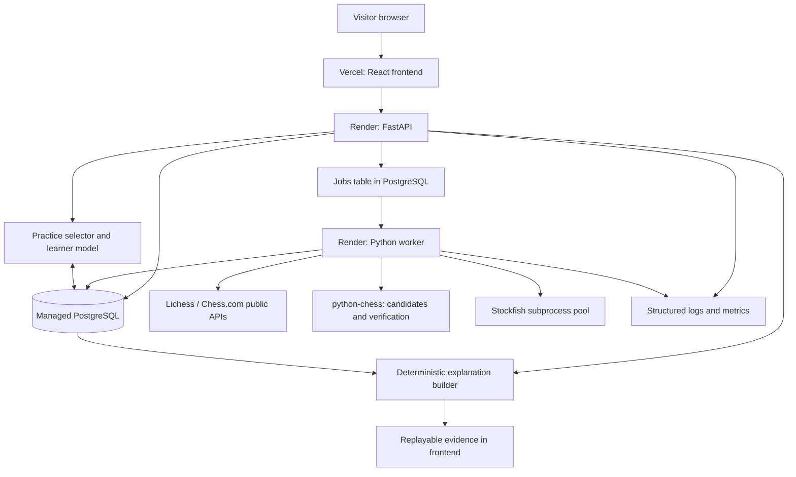

# ChessLab: complete implementation and deployment plan

Version: 1.0 · Prepared 15 October 2026 · Status: implementation blueprint

## 1. The destination

Build a public web application where a visitor can immediately play chess against an engine, import their existing games, understand verified tactical mistakes, practice related positions, and track concept-specific progress.

**Product goal:** help beginner and intermediate players recognize recurring tactical mistakes in unfamiliar positions, starting with evidence from their own games.

**Portfolio thesis:** this project demonstrates reliable software delivery and an evaluated AI learning system. Its contribution is the connection between game analysis, supported explanations, targeted exercises, and measurement. Do not claim the individual features or their combination are globally unprecedented.

**One-sentence pitch:** “ChessLab turns your games into evidence-backed tactical lessons and personalized practice, then measures whether you can recognize the pattern in new positions.”

### The public release must deliver

- A working HTTPS frontend URL and a deployed backend, database, and worker.
- Guest access without requiring a chess-platform password or registration.
- A responsive chessboard with complete standard-chess rules and a playable AI opponent.
- A choice of side and strength, move history, promotion choice, restart, resignation, and PGN export.
- Analysis after a game, with verified missed knight-fork opportunities and hanging-piece mistakes.
- Lichess username import, Chess.com username import, and PGN upload.
- Incremental analysis of up to 200 eligible imported games, with progress and cancellation.
- Deterministic explanations linked to replayable evidence.
- A curated Lichess practice pool with both supported themes.
- Recorded attempts and a provisional concept-specific Elo baseline for exercise selection.
- A progress screen that distinguishes practice performance from real-game performance.
- A reproducible engine comparison between the original JavaScript engine and Stockfish.
- A precomputed demonstration that remains useful when a provider or analysis service is unavailable.
- A public methodology page explaining evaluation, limitations, third-party components, and data use.

“Most advanced features” means the complete supported experience above. It does not mean training a stronger chess engine than Stockfish. Logistic regression, BKT, adaptive opponents, and LLM rewording are subsequent extensions with evidence requirements; they do not block this release.

### Representative visitor journey

1. Open the link and select **Play now**, **Analyze my games**, or **Explore a sample**.
2. Play as either color. The interface stays responsive while the engine thinks.
3. Finish or resign, then select **Review game**.
4. See a missed tactic, the alternative move, its continuation, and a short explanation.
5. Select **Practice this idea** and solve a different position.
6. Complete several attempts and see provisional progress with an honest sample count.
7. Optionally import a username and receive progressively richer findings from previous games.

### Boundaries

Standard chess only. No live multiplayer, tournament platform, payments, voice assistant, full opening course, or self-play reinforcement-learning training. No analysis of ongoing external games. No universal claims about detecting every tactical or positional mistake.

## 2. What exists and what changes

The repository currently contains a static HTML/CSS/JavaScript application. `js/main.js` mixes UI handling, piece-square evaluation, minimax with alpha-beta pruning, and game controls. `js/chess.js` supplies rules. The README contains only the project title. There is no application backend or deployment configuration in the inspected root.

Preserve the original engine as a credited baseline. Extract it from DOM-dependent code and execute it in a Web Worker. Introduce the new application alongside the existing files until the first replacement game flow works. Do not delete the old implementation before parity checks and a recoverable Git checkpoint.

Alpha-beta is a valid search approach; stronger product behavior comes from better analysis, user modeling, and engineering. Stockfish supplies the production chess strength. Your work supplies diagnosis, practice orchestration, evaluation, and the product experience.

## 3. Technology and architecture

### Recommended starting stack

| Area | Choice | Purpose |
|---|---|---|
| Frontend | React, TypeScript, Vite | Typed interactive interface and static deployment |
| Board UI | Maintained React chessboard component, chosen after compatibility/license check | Accessible rendering and move interaction |
| Client rules | Maintained chess.js release | Fast local legal-move feedback; backend remains authoritative |
| API | Python, FastAPI, Pydantic | Validated application endpoints and OpenAPI contract |
| Persistence | PostgreSQL, SQLAlchemy, Alembic | Durable games, evidence, jobs, attempts, migrations |
| Queue | PostgreSQL jobs table with leases | Durable background work without another infrastructure service |
| Worker | Separate Python process/container | Imports, Stockfish work, diagnosis, batch analysis |
| Chess tooling | python-chess and pinned Stockfish binary/network | Rules, PGN handling, UCI engine integration |
| Frontend tests | Vitest and Playwright | State behavior and end-to-end journeys |
| Backend tests | pytest against PostgreSQL where required | Chess behavior, queue correctness, API ownership |
| Local runtime | Docker Compose | Reproduce PostgreSQL, API, and worker on Windows or Linux |
| Hosting | Vercel frontend; Render API, worker, managed PostgreSQL | Public frontend and durable server-side execution |
| CI | GitHub Actions | Checks, images, deployment gates |

Pin actual compatible versions during setup, commit lockfiles, and record the Stockfish version and network checksum. Avoid fixing speculative future dependency versions in this plan.

### Deployment topology



The selector and explanation builder are modules inside the API application, not separate services. PostgreSQL and its jobs table are the same database. The worker imports application modules but starts through a separate entry point.

Use ordinary HTTP requests plus status polling first. WebSockets are unnecessary for a turn-based single-player game. Polling should stop in terminal states and back off when tabs are hidden.

### Suggested repository shape

```text
apps/web/                 React application, routes, board, API client
services/backend/
  app/api/                HTTP routes and access checks
  app/domain/             Game, tactic, exercise, attempt rules
  app/importers/          Lichess, Chess.com, PGN normalization
  app/analysis/           Engine adapter, candidates, verification
  app/learning/           Elo baseline, selection, later models
  app/jobs/               Queue claims, leases, handlers
  app/models/             Database models
  app/main.py             API entry point
  app/worker.py           Worker entry point
  migrations/             Alembic migrations
  tests/                  Unit and integration tests
packages/legacy-engine/   Extracted JS engine and benchmark adapter
data/manifests/           Dataset provenance, subsets, checksums
evaluation/              Dataset preparation and evaluation scripts
docs/                    Architecture decisions, API notes, operations
infra/                   Dockerfiles and Render configuration
compose.yaml
.github/workflows/
```

Do not commit production credentials, full database exports, engine build caches, or the entire puzzle database.

## 4. Core contracts and data design

Establish these contracts before parallel feature development or extensive UI work. “Evidence” means a versioned structured record of what was observed and verified, rather than generated prose.

### Database entities

| Entity | Essential fields and meaning |
|---|---|
| Visitor | ID, hashed opaque session token, creation/expiry timestamps |
| Game | ID, owner, source, source game ID, player color, PGN, initial FEN, status, revision, result, timestamps |
| Game move | Game ID, ply, UCI, SAN, resulting FEN; unique game/ply |
| Import | Owner, provider, username, target limit, fetched/analyzed counts, state, errors |
| Job | Kind, owner, payload reference, priority, status, run-after, attempts, lease expiry, heartbeat, deduplication key |
| Analysis run | Game, pipeline version, engine version/network, limits, coverage, state |
| Tactical evidence | Analysis run, ply, concept, actual/candidate moves, target pieces, verified line, benefit, score perspective, coverage, explanation version |
| Puzzle | Source ID, source FEN, setup move, playable FEN, solution, themes, rating/deviation, source game, dataset version |
| Practice session | Owner, puzzle, presentation mode, model version, pre-attempt prediction, start time |
| Attempt | Practice session, submitted moves, correctness, hints, elapsed time, finish time, theme attribution |
| Concept rating | Owner, concept, rating, attempt count, provisional flag, model version |
| Benchmark run | Engine versions, position set, hardware/runtime, budget, results |

Use database uniqueness constraints for idempotency, not only Python pre-checks. Index owner/time queries, ready jobs, source game IDs, and puzzle theme/difficulty filters.

### Session and privacy model

For the first release, create a high-entropy opaque guest token through the API. Store it in browser local storage and send it as a bearer token over HTTPS. Hash it in the database. Treat it as a credential: never log it or place it in URLs. Use a strict content-security policy and avoid arbitrary HTML rendering. Server-side expiry determines retention; a provisional 30-day inactivity window is a product default to confirm during implementation.

This provides persistence on the same browser, not cross-device recovery. Explain that clearing browser storage loses access. A future account can claim guest data through an authenticated migration. Do not imply that entering a public chess username proves account ownership.

Every user-specific endpoint must verify ownership, including job polling, game review, attempts, and deletion. Provide **Delete my data** and clearly distinguish a precomputed public demo from private visitor history.

### Initial HTTP endpoints

All are examples of the intended contract; generate final schemas from FastAPI and use them in the frontend.

| Endpoint | Behavior |
|---|---|
| `POST /v1/sessions` | Issue guest credential; rate-limited |
| `POST /v1/games` | Create standard-chess game with side and engine profile |
| `GET /v1/games/{id}` | Return authoritative state, revision, moves, pending turn |
| `POST /v1/games/{id}/moves` | Accept UCI move, expected revision, request ID; validate and schedule reply |
| `POST /v1/games/{id}/resign` | Set result, cancel pending replies safely |
| `GET /v1/games/{id}/pgn` | Export game |
| `POST /v1/imports` | Queue provider import, maximum 200 eligible completed games |
| `POST /v1/imports/pgn` | Validate bounded PGN upload and queue ingestion |
| `GET /v1/imports/{id}` | Report fetch and analysis progress separately |
| `POST /v1/games/{id}/analysis` | Create/reuse versioned analysis job |
| `GET /v1/jobs/{id}` | Return state, progress, retry information, safe error |
| `POST /v1/jobs/{id}/cancel` | Request cooperative cancellation |
| `GET /v1/games/{id}/review` | Return evidence and analysis coverage |
| `POST /v1/practice/sessions` | Select exercise; keep solution private |
| `POST /v1/practice/sessions/{id}/moves` | Grade a move and advance solution state |
| `POST /v1/practice/sessions/{id}/hint` | Return graduated hint and persist its use |
| `GET /v1/progress` | Return separated game/practice metrics and sample counts |
| `DELETE /v1/me/data` | Delete/revoke visitor data and cancel owned work |
| `GET /health/live`, `GET /health/ready` | Process and dependency health |

Return structured error codes such as `ILLEGAL_MOVE`, `STALE_REVISION`, `IMPORT_RATE_LIMITED`, `ANALYSIS_PARTIAL`, and `ENGINE_UNAVAILABLE`. Never leak tracebacks to users.

### Versioned evidence record

At minimum include: game and ply, initial position and relevant history, side to move, actual move, recommended move, tactical targets, verification line, engine limits/version, score perspective, result type (mate or centipawns), pipeline version, and explanation template version.

Store replayable move history because FEN alone does not preserve repetition history. Keep mate values separate from centipawns. A centipawn score is neither material accounting nor a percentage chance of winning.

## 5. Execution sequence

Each phase specifies what to implement, how to implement it, and the gate that makes it complete. Follow the sequence; release early checkpoints without dropping the final feature requirements.

### Phase 0 — Freeze scope and preserve the baseline

**Step 0.1: Record current behavior.** Run the existing page locally, list working controls, capture a small set of representative positions, and document known defects. This establishes migration expectations.

**Step 0.2: Preserve the starting point.** Check Git status, commit only intended changes, and create an implementation branch such as `codex/chesslab-foundation`. Record original engine provenance and licenses, including piece-square table sources and third-party assets. Select a compatible repository license after reviewing bundled dependencies.

**Step 0.3: Write acceptance stories.** Convert the visitor journey into testable statements. Example: “A guest choosing Black sees a legal engine opening move and can make their reply without refreshing.” Include the completed-game review and practice journey.

**Step 0.4: Choose deployment resources.** Confirm access to GitHub, Vercel, and Render, select a nearby backend/database region, and set an affordable monthly ceiling. Inspect current service prices and terms at provisioning time; this plan does not assume a permanently free production backend.

**Outputs:** acceptance checklist, baseline notes, architecture decision records, hosting decision, license inventory.

**Gate:** every final-release requirement has a testable outcome and a planned phase.

### Phase 1 — Establish the application and deploy a thin slice

**Step 1.1: Scaffold the repository structure.** Create the React/TypeScript application and Python API/worker package. Add dependency locks, formatting/linting commands, `.env.example`, and ignore rules. Document supported runtime versions.

**Step 1.2: Start PostgreSQL locally.** Add Compose services for database, API, and worker. Use a health check and a named development volume. Keep database access behind the API. On Windows, run Linux containers through Docker Desktop/WSL2; document native alternatives only if needed.

**Step 1.3: Create the first migrations.** Add visitors, games, jobs, and indexes. Use Alembic rather than automatically creating tables on API startup. Confirm a fresh database can migrate from empty state.

**Step 1.4: Implement guest sessions and health endpoints.** Connect a basic frontend screen to the API. Show explicit loading/error states. Generate an OpenAPI contract and a typed client or generated TypeScript types.

**Step 1.5: Deploy the thin slice.** Publish the frontend, API, database, and idle worker now, using the deployment procedure in section 10. Verify a guest session survives an API restart.

**Outputs:** working local stack and initial public URLs.

**Gate:** an incognito browser can load the hosted frontend, create a guest session, and receive a real backend response. This early checkpoint exposes CORS, networking, and build problems before feature work.

### Phase 2 — Deliver a complete playable game

**Step 2.1: Build the game interface.** Provide side/strength selection, board, move list, turn indicator, thinking state, promotion dialog, resign, restart, and export. Support mouse, touch, and click-to-move with visible focus and labeled controls. Responsive layout must keep the board usable on small screens.

**Step 2.2: Make the backend authoritative.** Reconstruct the board from persisted initial position and legal move history. Validate each submitted move with python-chess. Update state in a short transaction using the expected revision. Enforce whose turn it is. Never trust a submitted client FEN as the saved game's truth.

**Step 2.3: Implement all termination rules.** Handle checkmate, stalemate, insufficient material, resignation, automatic draw rules, and claimable draw rules. Expose a claim action when valid instead of conflating every possible draw with an automatic result. Include castling, en passant, and all four promotion choices. Leave chess clocks out of this release unless separately scoped; record wall-clock thinking time only as telemetry.

**Step 2.4: Integrate Stockfish.** Install a compatible pinned Linux binary and required network files in the worker image. Start bounded UCI subprocesses through python-chess. Set threads/hash limits from environment variables. Provide a few engine profiles with measured move budgets; label them descriptive strengths, not unvalidated Elo claims.

**Step 2.5: Schedule AI turns safely.** Persist the player's move and an engine-turn job atomically. Carry game ID and expected revision in the job. Compute outside database transactions, then save the engine move only if the game is still active at that revision. Duplicate jobs and retries must never create two replies. Choosing Black queues the first engine turn immediately.

**Step 2.6: Recover the UI.** Poll the game/job while waiting. Refreshing should resume the same game. On engine failure, preserve the position and expose retry. A stale response must not change a restarted game. An offline banner should distinguish network loss from engine thinking.

**Step 2.7: Preserve the JS engine.** Extract search/evaluation from DOM code into a function with explicit inputs and outputs. Run it in a Web Worker with a time/cancellation boundary. Initially expose it as an experimental original-engine mode. For server-tracked games, validate returned moves through the same backend path and label the engine used. Keep coach analytics aware of engine mode.

**Gate:** a new visitor can complete and export a standard-chess game on the public URL. Rules edge cases, duplicate clicks, refresh, restart during thinking, and worker failure have been exercised.

### Phase 3 — Build the durable queue and import pipeline

**Step 3.1: Implement job leasing.** Claim ready rows using a short transaction with `FOR UPDATE SKIP LOCKED`; set a lease and commit before computation. Heartbeat long-running work, reclaim expired leases, apply bounded retry/backoff, and mark terminal failures. Cancellation is cooperative at safe boundaries. A process can crash after executing work, so handlers must be idempotent.

**Step 3.2: Protect interactive play.** Prioritize engine turns over background batches. Break analysis into small resumable units rather than monopolizing the worker for 200 games. Reserve bounded engine capacity for play and cap analysis concurrency. If measured resources cannot sustain both, deploy separate interactive and batch workers. Repeated interactive traffic must not starve all batch work: use aging or a reserved batch slot where capacity permits.

**Step 3.3: Implement the Lichess adapter.** Fetch completed standard-chess games through the documented export API, respecting its request guidance. Store source IDs, exact PGN, player color, time control, and completion time. Reject unsupported variants. Report nonexistent users and empty histories clearly.

**Step 3.4: Implement Chess.com after the first adapter works.** Fetch the archive list, visit newest relevant monthly archives, and stop after collecting the requested number of eligible games. Normalize into the same internal game schema. Fetch sequentially; handle 429 responses, timeouts, and provider outages.

**Step 3.5: Support PGN upload.** Bound byte size, game count, move count, and parsing time. Validate initial positions and legal replay; support valid FEN-tagged starts. Return per-game errors for malformed content. When player identity is ambiguous, ask which side should be reviewed. Treat uploaded headers as untrusted text.

**Step 3.6: Add incremental persistence.** Deduplicate source games, checkpoint imported pages/months, and resume safely after retries. Allow users to return later. Display fetched, eligible, analyzed, failed, and excluded counts separately. Start analysis after the first small batch rather than waiting for all downloads.

**Step 3.7: Address onboarding gaps.** Provide a precomputed sample history for visitors without an account. Explain that historical findings seed concept recommendations but do not measure puzzle-solving ability or knowledge directly.

**Gate:** both providers and PGN upload can ingest a bounded history without duplication; imports recover from worker interruption, and play stays responsive during a batch import.

### Phase 4 — Create and verify tactical evidence

**Step 4.1: Define the supported taxonomy.** Begin with missed beneficial knight forks. Define whether a king attack counts as a fork target, what benefit must be demonstrated, and what engine budget supports verification. Next add hanging-piece mistakes with an explicit distinction between “undefended” and “legally capturable for a net benefit.” Write positive and negative examples before implementation.

**Step 4.2: Generate candidates cheaply.** At each eligible player turn, inspect legal knight moves and their resulting attacks. Candidate generation aims for useful coverage, not final correctness. Use attack queries carefully: pinned pieces still count as attackers in python-chess, so geometric attacks alone cannot prove a tactic.

**Step 4.3: Verify tactical benefit.** Analyze the candidate position and opponent defenses, using Stockfish as a bounded strength reference. Check capture of the forking piece, checks, counter-threats, pins, exchanges, and forcing replies. Identify a concrete benefit in a legal continuation and whether it persists under the best analyzed defense. Do not infer guaranteed material gain merely from a large centipawn score.

**Step 4.4: Establish a missed opportunity.** Compare the player's actual move against the verified alternative from the same evaluation perspective and comparable search limits. If the actual move is equally good, record an alternative idea rather than a mistake. Avoid duplicate findings for the same unresolved opportunity across adjacent plies. Keep “missed a fork” separate from “allowed an opponent fork.”

**Step 4.5: Define analysis coverage.** Choose either exhaustive supported-candidate scanning under a finite budget, or a cheaper screening pass followed by deeper verification. If screening excludes positions, label counts as detected findings under that pipeline. Do not present them as a complete census. Store skipped/failed positions and partial status.

**Step 4.6: Add hanging-piece verification.** Look for actual moves that permit a profitable legal capture. Distinguish sound sacrifices, recaptures, compensation, and check obligations. Use separate evidence types for “left own piece capturable” and “missed a profitable capture.” Do not attribute an entire strategic loss to a simple undefended-piece rule.

**Step 4.7: Persist evidence independently from wording.** Save actual/candidate moves, targets, variations, benefit, limits, version, and coverage. Replay every stored variation before accepting it. Cache only with a key that captures relevant game history, engine/pipeline version, variant, and limits; do not blindly cache repetition-sensitive analysis by FEN alone.

**Step 4.8: Build deterministic explanation templates.** Example structure: “The alternative move attacks [targets]. After the analyzed reply [move], [continuation] wins [verified benefit]. Your move [actual] missed this opportunity.” Render only supported slots. Show “best found at this analysis budget” rather than claiming a mathematical proof from finite search.

**Gate:** the review screen displays validated evidence, replayable variations, and bounded claims for both supported concepts. Reviewed false-positive cases are fixed or explicitly unsupported.

### Phase 5 — Build targeted practice

**Step 5.1: Prepare a bounded puzzle subset.** Download/stream the official Lichess puzzle export in an offline preparation script. Filter to supported themes, a useful difficulty spread, and adequate rating reliability. Start with a few thousand validated exercises, not the full multi-million-row dataset in the production database.

**Step 5.2: Normalize puzzle positions correctly.** Preserve original FEN and UCI moves. Apply the first listed move to produce the position shown to the solver. The second move begins the solver's answer. Validate the full line and store provenance, rating deviation, dataset date, and checksum.

**Step 5.3: Separate serving and grading.** Return the board and presentation data without the solution. Submit moves to the backend, validate legality, grade, and automatically play the expected opponent response. Complete an exercise only after the required solver moves. Support documented alternative checkmates where applicable. For unrecognized plausible alternatives, offer a clear review path rather than silently equating a stored-line mismatch with universal chess incorrectness.

**Step 5.4: Design graduated hints.** Reveal the concept, then relevant piece/squares, then the answer. Save every hint event. For the learner model's first target, success means the full exercise completed on the first attempt without hints; retain richer outcome fields for later research.

**Step 5.5: Connect diagnosis to practice.** A review finding chooses a matching concept and a new puzzle. Exclude the same source game, exact position, recent repeats, and known evaluation holdouts. Do not reveal the concept on assessment exercises; labeled practice and blind assessment measure different things.

**Step 5.6: Persist attempts idempotently.** Use a unique completed outcome per practice session, server timestamps, and bounded elapsed-time handling. Record mode, hints, selected difficulty, prediction, model version, and preceding exposure count. Restarting or resubmitting must not inflate rating updates.

**Gate:** import/play → review → different exercise → graded outcome → saved attempt works end to end on the hosted application.

This is the first complete portfolio checkpoint. Deploy and record a short demo now. Continue to the remaining phases for the final release promised in section 1.

### Phase 6 — Add interpretable personalization and progress

**Step 6.1: Introduce provisional per-concept ratings.** Use `P(solve) = 1 / (1 + 10 ** ((puzzle_rating - concept_rating) / 400))` as a baseline. Update the player's concept rating after eligible outcomes with a documented K schedule. Do not mutate the imported public puzzle ratings initially. Label the local scale as provisional and do not equate it with playing Elo or Lichess rating.

**Step 6.2: Handle cold start and multi-theme puzzles.** Start with a conservative population default or short placement set; evaluate any initialization from playing rating before trusting it. Mark the first attempts provisional. Attribute a puzzle to a reviewed primary concept or exclude ambiguous puzzles from concept updates. Avoid applying the same result independently to many skills as if each had been measured separately.

**Step 6.3: Select practice.** Choose the requested/weak concept, then rank unseen exercises near an initial target success range such as 60–80%. Treat that range as a tunable product choice. Mix in overdue review and some exploration. Log selection reasons and predicted probabilities. Avoid sending a discouraged player endlessly into their weakest theme.

**Step 6.4: Build honest progress views.** Show attempt count, first-try unassisted success, difficulty distribution, concept rating, and date range. Separate instructed practice, blind assessments, and actual-game opportunity/miss rates. Use uncertainty or small-sample indicators. Never infer improvement solely from solving easier exercises.

**Step 6.5: Add logistic regression only when data supports it.** Build a chronological feature pipeline using only pre-attempt information. Train an interpretable model on prior performance, difficulty, prior hints, exposures, and time since practice. Compare with Elo and a constant base-rate model on future attempts, including held-out players. Keep Elo in production if regression fails to improve useful metrics.

**Step 6.6: Keep BKT optional.** Explore it only if sequential data and a defensible concept assignment exist. It models a latent knowledge state, not simply a replacement chess rating. Document assumptions and parameter stability. Do not deploy a model merely because it is more sophisticated.

**Gate:** baseline selection, saved predictions, provisional ratings, and truthful progress work live. More complex models have an offline report before any production adoption.

### Phase 7 — Evaluate the system and run a pilot

**Step 7.1: Create an evaluation specification.** State the task: per-position candidate identification, beneficial tactic verification, or missed-opportunity diagnosis. These are different targets and require different labels. Freeze thresholds before the final test.

**Step 7.2: Build the puzzle benchmark.** Keep a held-out subset covering difficulty, both themes, and counterexamples. Align labels with the relevant solution ply rather than applying a puzzle-level tag blindly to its initial position. Report this as theme-label agreement, not definitive real-game accuracy. Document that automated tag generation may share logic with your detector.

**Step 7.3: Build an independent real-game set.** Sample ordinary player turns as well as detector positives, including difficult negatives such as pinned attackers, sacrifices, capturable forking pieces, and equally good alternatives. Aim initially for roughly 150–300 independently reviewed positions as workload permits. Keep all sampled positions together when estimating prevalence-sensitive precision; challenge sets are separate. Use a second reviewer for a subset and adjudicate disagreements. If reviewers are limited, describe that limitation.

**Step 7.4: Prevent leakage.** Split by source game and relevant player/time boundaries; deduplicate exact positions and track related positions. Freeze evaluation puzzles out of practice selection. Pilot post-tests must use unseen, difficulty-matched examples with hidden themes.

**Step 7.5: Produce reports.** Report precision, recall, sample counts and intervals for the independently labeled task; theme agreement on puzzle data; illegal-line rate; diagnosis coverage; and latency. Compare Elo/regression using calibration plots, Brier score, and log loss when sufficient data exists. Keep separate test reports for existing versus new players.

**Step 7.6: Run a voluntary 10–20-player, three-week pilot.** Explain what is collected and allow deletion. Collect a short blind pre-test, repeated practice sessions, and a blind unseen post-test, plus a delayed check if feasible. Keep assessments at similar difficulty. Record attrition, exposure, hints, and qualitative feedback. Do not organize uncontrolled before/after results into a causal claim.

**Step 7.7: Write an honest results page.** Show what worked, failure examples, and limitations. Practice improvement does not establish better tournament performance. If improvement is absent, explain the result and product changes it suggests. Report actual numbers only.

**Gate:** a versioned evaluation script, documented datasets/provenance, reproducible report, and initial pilot observations exist. A full pilot can continue after public launch; a three-week study is not required to test deployment readiness.

### Phase 8 — Add engine comparison and final product polish

**Step 8.1: Compare engines fairly.** Use a fixed versioned position set and equal wall-clock budgets, report browser/server hardware separately, and label environment differences. Record latency, timeout rate, legal moves, and tactical outcomes against an independent stronger analysis reference. Do not compare node counts across implementations as equivalent work or infer Elo from a tiny match.

**Step 8.2: Explain your engineering choices.** Provide a concise public page showing why the original engine struggles, what alpha-beta does, and what the product adds around Stockfish. Attribute Stockfish's playing strength clearly. Keep implementation detail out of the normal play flow.

**Step 8.3: Polish navigation and accessibility.** Complete Play, Import, Review, Practice, Progress, Demo, and Methodology routes. Add empty states, loading states, reconnect paths, labels, contrast checks, touch behavior, and keyboard navigation. Check the board component's actual accessibility rather than assuming it.

**Step 8.4: Stabilize the demo.** Seed a legally sourced, labeled sample game/history and cached review. Ensure it works without making external API requests. Make clear that sample progress is fictional or illustrative; never display it as the visitor's own result.

**Gate:** a recruiter can discover and complete the product's core journey without instructions from you.

## 6. Queue, engine, and capacity details

### Job states

`queued → running → succeeded`, with `retry_wait`, `failed`, `cancel_requested`, and `cancelled` branches. Partial analysis is a domain result with coverage, not a silent successful full analysis.

Choose and document lease/heartbeat/retry values after measuring typical work-unit duration. Add randomized backoff for external failures, cap attempts, and quarantine repeated failures for operator inspection. Error categories determine retryability: a malformed PGN should not repeatedly retry like a temporary timeout.

### Initial budget policy

Start with bounded, configurable budgets, then tune on the deployed machine:

- Maximum 200 eligible games per requested history; analyze a small initial batch first.
- Per-game ply limit and per-upload byte/game limits.
- Per-position node/time budget, per-game total budget, and batch cancellation checks.
- Small engine pool with explicitly bounded threads and hash memory.
- Low per-visitor active-import and active-analysis limits.
- Shared provider request coordination across workers so each visitor does not independently evade provider limits.

These are resource controls, not accuracy guarantees. Benchmark the actual configuration and display partial coverage. Never let a web request specify arbitrary Stockfish options, command paths, thread counts, or unbounded search depth.

### Capacity calculation

Measure p50/p95 engine-turn time, positions analyzed per second, and resident memory per engine process. Estimate total memory as API + worker overhead + database connections + engine processes/hash + operating headroom. Run a mixed workload: simultaneous games plus a history import. Define the supported concurrency from measurements and expose a friendly queue-busy state above capacity.

Target initially: a bounded engine turn completes within a few seconds under the documented small pilot load, and the board remains interactive. Record actual p95 results rather than claiming this target has been achieved.

## 7. Verification strategy

| Layer | Meaningful checks |
|---|---|
| Rules | Castling through check, en passant exposing king, underpromotion, mate, stalemate, claimable/automatic draws |
| Game API | Ownership, turn order, revision conflict, duplicate request, engine reply after resignation/restart |
| Queue | Competing workers, worker crash, lease expiry, duplicate delivery, cancellation, retry exhaustion |
| Imports | Provider fixtures, monthly traversal, 429/backoff, empty user, malformed PGN, duplicates, partial completion |
| Diagnosis | Valid fork, pinned/capturable attacker, countercheck, sacrifice, equivalent alternative, mate-score handling |
| Practice | Setup-move normalization, solution not leaked, multi-move grading, hint persistence, duplicate completion |
| Learner model | One rating update per attempt, pre-attempt features, calibration reports, provisional behavior |
| End to end | Guest play → finish → review → practice → progress; username import → partial review; refresh recovery |
| Deployment | Browser-to-API connectivity, persistence after restart, worker processing, health/readiness, deep-link reload |

Use real PostgreSQL integration tests for locking, uniqueness, and migrations; SQLite cannot establish those properties. Keep external provider responses in reviewed test fixtures so CI does not depend on their live uptime. Run a small read-only provider smoke check separately when needed.

Use unit tests for domain logic and targeted integration tests for boundaries. Avoid broad snapshot suites that merely copy UI implementation. Run the required CI suite once per revision; broaden checks when failures or changes justify it.

## 8. Reliability, security, and data operations

1. Validate usernames, upload size, move strings, variants, and IDs at API boundaries. Build provider requests from fixed allowlisted domains and validated path segments; never fetch arbitrary URLs from uploads or headers.
2. Use bearer ownership checks for every private resource. CORS is not authentication. Apply request limits to sessions, imports, and compute-heavy endpoints.
3. Keep database and provider/LLM credentials server-side. Only public configuration may use Vite's `VITE_` prefix because it is exposed in frontend bundles.
4. Limit PGN parser work and engine subprocess resources. Run containers as a non-root user where practical. Use safe argument arrays for subprocess invocation.
5. Keep production PostgreSQL private to backend services and require the provider's supported TLS/network configuration. Set bounded connection pools for API and worker.
6. Log request/job IDs, stage, duration, and safe error codes. Exclude guest tokens, database URLs, raw private uploads, and unnecessary personal information.
7. Track queue wait, processing latency, engine restarts, import failures, retry counts, stale leases, API errors, and database saturation. Store metrics or aggregate logs beyond one process restart.
8. On provider outage, preserve completed imports and permit PGN upload/sample demo. On engine outage, preserve games, allow retry, and show sample analysis. Do not fabricate fresh analysis.
9. Schedule cleanup for expired guest data and abandoned practice sessions. Keep non-identifying aggregate evaluation results only under the stated data policy.
10. Enable database backups and perform one documented restore into a disposable database before final launch. Verify guest data deletion and cancellation behavior.
11. Review dependency and asset licenses, publish notices, and meet applicable source-distribution obligations for the chosen packages and engine build. Document exact third-party versions and origins.

## 9. Optional extensions after the complete release

### Logistic regression and BKT

Follow phase 6's evaluation gates. Version features, model artifacts, and training data manifests. Deploy a champion/challenger setup only if traffic/data volume makes it useful; an offline comparison is sufficient for an initial portfolio.

### LLM rewording

Only add it if deterministic explanations are a demonstrated usability limitation. Feed a small validated evidence record, request a constrained output, and validate the result against permitted facts and legal variations. Square/move matching alone cannot verify a sentence's meaning. Revert to the deterministic template on failure, timeout, or budget exhaustion. Do not let the LLM select moves, identify tactical truth, or assign learner ability.

### Adaptive opponent

This requires selecting legal, plausible moves that create learning opportunities without misleading strength claims. Evaluate separately against ordinary difficulty adjustment. It is a research extension, not a launch dependency.

## 10. Exact deployment procedure

The intended production layout is a static frontend on Vercel, a long-running API and worker on Render, and managed PostgreSQL in the backend's region. Hosting plans and prices change; verify them when provisioning.

Render documents that free web services spin down after inactivity. Use appropriately provisioned always-on services for the intended reliable recruiter experience. Do not substitute a request-bound serverless function for a durable engine-analysis worker. Production state belongs in PostgreSQL, not a service's ephemeral filesystem.

### Step 10.1 — Prepare reproducible builds

- Add a frontend build command that type-checks and emits `apps/web/dist`.
- Add a backend Dockerfile with locked Python dependencies, pinned compatible Stockfish binary/network, application package, and non-root runtime.
- Use one image with separate API and worker commands. Verify the engine runs on the hosting CPU architecture; avoid distributing a binary requiring unsupported instruction sets.
- Configure the API to bind `0.0.0.0` and the platform-provided `PORT`. Start the worker through the installed Python module entry point.
- Add `.dockerignore`, health checks, and graceful shutdown. A worker receiving termination should stop accepting new jobs and leave interrupted work recoverable through leases.

### Step 10.2 — Create PostgreSQL

- Provision managed PostgreSQL in the chosen region and select durable storage/backups appropriate to the release.
- Put `DATABASE_URL` into backend secret settings; use internal networking where supported.
- Run migrations from a single controlled deployment step, not independently in every API replica.
- Seed the versioned practice subset and public demo through an idempotent command. Re-running it must not duplicate exercises or visitor records.

### Step 10.3 — Deploy API

- Create a Render web service from the backend image/repository path.
- Set `DATABASE_URL`, `ALLOWED_ORIGINS`, session hashing/expiry configuration, safe rate-limit settings, log level, and environment name.
- Set the health-check route and bounded server worker/connection counts.
- Deploy; verify live and ready endpoints over HTTPS and test a session/game creation from an API client.
- Readiness should check essential configuration/database availability without invoking costly engine searches on every health request.

### Step 10.4 — Deploy worker

- Create a Render background worker from the same application revision.
- Set database URL, engine path, thread/hash limits, interactive/batch concurrency, job lease configuration, provider user-agent, and bounded analysis budgets.
- Keep API/worker code compatible with the same migration and evidence versions.
- Submit a canary job. Verify it is claimed, completed, persisted, and observable. Restart the worker during a test job and verify safe recovery.
- Keep puzzle preparation out of normal worker startup; deploy a prepared subset or run an explicit data-load operation.

### Step 10.5 — Deploy frontend

- Import the repository into Vercel and select `apps/web` as the application root.
- Configure the Vite build command and `dist` output. Set `VITE_API_BASE_URL` to the public HTTPS API base.
- Configure a SPA rewrite so direct navigation to `/play`, `/review/...`, and `/practice` loads the app.
- Deploy and record the production frontend origin.
- Add that exact origin to the API CORS allowlist; configure staging/preview origins deliberately rather than accepting every origin.
- Confirm API error responses also carry appropriate CORS headers. Use bearer authorization headers and configure allowed methods/headers.
- Rebuild the frontend when changing build-time configuration. Never place private keys in a `VITE_` variable.

### Step 10.6 — Verify full public behavior

From an incognito browser on another network/device, run this checklist:

- [ ] Open the frontend with no local development server running.
- [ ] Choose Black and receive a legal engine opening move.
- [ ] Make moves, refresh, and resume the authoritative game.
- [ ] Exercise promotion and a terminal state through prepared test positions.
- [ ] Complete/resign a game, review findings, and launch related practice.
- [ ] Submit a practice attempt and verify progress persists after refresh.
- [ ] Import a real consenting/test username from each provider; confirm partial progress and deduplication.
- [ ] Upload valid and invalid PGN files; inspect safe error handling.
- [ ] Run an import while another visitor plays; measure interactive latency.
- [ ] Cancel a batch and verify it stops consuming work at the next safe boundary.
- [ ] Confirm a second guest cannot fetch the first guest's games/jobs/attempts.
- [ ] Delete guest data and confirm credentials no longer expose deleted resources.
- [ ] Open the sample demo during a simulated provider outage.
- [ ] Restart API and worker; confirm durable records survive.
- [ ] Reload a deep frontend URL and confirm SPA routing works.
- [ ] Inspect the browser console/network for CORS, mixed content, missing assets, and credential leaks.

### Step 10.7 — Add CI and controlled releases

- On pull requests: install from lockfiles; lint/type-check; run backend/frontend checks and PostgreSQL integration tests; build the frontend and backend image.
- Run Playwright against an isolated seeded environment for the essential journey.
- Keep preview deployments connected to staging data, never production guest data.
- Deploy only revisions that passed required checks. Run backward-compatible migrations before compatible application releases.
- After deployment, run a smoke test. Record app revision, engine version, pipeline/model version, and dataset version.
- For rollback, redeploy the last known-good compatible API/worker/frontend revision. Avoid destructive schema changes until old code no longer needs the fields; use expand/migrate/contract changes.

### Step 10.8 — Record the deployment runbook

Create `docs/OPERATIONS.md` with actual service names/URLs, regions, environment variable names, migration/seed commands, backup/restore procedure, log locations, alert thresholds, restart/rollback steps, and measured capacity. Keep secret values out of it.

**Deployment is complete only when the browser journey works across real hosted services. A successful build or frontend preview alone is insufficient.**

## 11. Scheduling and checkpoints

Treat the following as sequencing guidance, not a promise. A planning range is roughly 120–200 focused engineering hours plus pilot calendar time, depending on familiarity and diagnosis complexity. Re-estimate after the first playable deployment; tactical validation may dominate the work.

| Checkpoint | Included work | Exit outcome |
|---|---|---|
| A: Public playable slice | Phases 0–2, first deployment | A stranger can play a complete game through the public link |
| B: Complete learning loop | Queue/import, knight forks, subset, templates, attempts | Imported or played game produces a supported lesson and new practice |
| C: Final product features | Second importer, hanging pieces, Elo, progress, comparison, polish | All section 1 features are available live |
| D: Evidence and operations | Evaluation, load checks, restore check, docs, pilot start | Product claims are supported and the deployment can be operated |
| E: Research extensions | Regression/BKT/LLM only when justified | Measured improvement over the simpler baseline |

The first scope cut should be an optional extension. Keep play, the full learning loop, correct evidence, and deployment intact. If a supported detector fails evaluation, narrow its published claims and UI coverage rather than quietly presenting unreliable output.

## 12. Definition of done and portfolio package

### Functional release

- [ ] Every public-release requirement in section 1 has a working route and acceptance check.
- [ ] Guest sessions, standard-chess play, exports, both importers, and PGN upload work.
- [ ] Both supported concepts produce replayable, bounded explanations.
- [ ] Targeted practice records attempts, hints, predictions, and rating updates correctly.
- [ ] Progress differentiates provisional practice estimates from actual-game findings.
- [ ] Original-engine comparison is attributed, reproducible, and honestly bounded.

### Engineering release

- [ ] API, worker, and database survive the specified restart/retry scenarios.
- [ ] Interactive play meets the measured latency target under the documented load.
- [ ] CPU/memory, upload sizes, active jobs, and provider request rates are bounded.
- [ ] Ownership, deletion, migrations, backups, restore, and rollback are verified.
- [ ] Required checks pass on the exact deployed revision.

### AI and product evidence

- [ ] Dataset manifests, pipeline versions, thresholds, and evaluation splits are recorded.
- [ ] Puzzle theme agreement is separated from independent real-game diagnosis accuracy.
- [ ] Calibration claims are backed by saved pre-attempt predictions and held-out outcomes.
- [ ] Low samples, finite-search limits, and pilot confounders are stated clearly.
- [ ] No invented performance, Elo, user-count, or learning-improvement numbers appear.

### Recruiter-facing deliverables

- Replace the minimal README with the live link, a short pitch, screenshots, a 60–90-second demo, architecture, local setup, and results.
- Write concise architecture decisions: server authority; PostgreSQL queue; evidence before prose; bounded engine work; baseline before complex models.
- Include one technical case study tracing a false fork diagnosis through discovery, correction, and evaluation.
- Present original versus integrated work clearly: your original engine; Stockfish integration; your detection, evidence, learning, UI, and operations code.
- Add a resume bullet with actual measured values after launch. Example template: “Built and deployed a chess learning platform with asynchronous analysis, verified tactical explanations, and adaptive practice; evaluated [N] positions and served [N] pilot participants.”

## 13. Verified references and implementation reading

Consult these official sources when implementing; verify current API behavior and hosting terms again before release.

1. [Lichess API documentation](https://lichess.org/api) — game export contracts.
2. [Lichess API tips](https://lichess.org/page/api-tips) — serial requests and rate-limit recovery.
3. [Chess.com Published-Data API](https://www.chess.com/news/view/published-data-api) — public completed-game monthly archives and caching/rate guidance.
4. [Lichess open database](https://database.lichess.org/#puzzles) — CC0 puzzle export, schema, setup move, themes, ratings, and provenance.
5. [python-chess core documentation](https://python-chess.readthedocs.io/en/latest/core.html) — legal moves, attacks, pins, and board state.
6. [python-chess engine documentation](https://python-chess.readthedocs.io/en/latest/engine.html) — UCI subprocess integration and search limits.
7. [Stockfish documentation](https://official-stockfish.github.io/docs/stockfish-wiki/Advanced-topics.html) — search and evaluation background.
8. [Maia research](https://www.maiachess.com/blog/maia-v1) — prior human-like and personalized chess modeling; informs honest differentiation.
9. [Chess.com Game Review](https://support.chess.com/en/articles/8584089-how-does-game-review-work) — existing explanations/retry functionality.
10. [Vite on Vercel](https://vercel.com/docs/frameworks/frontend/vite) — frontend deployment and environment configuration.
11. [Render background workers](https://render.com/docs/background-workers) — long-running worker service model.
12. [Render free-service limitations](https://render.com/docs/free) — inactivity spin-down and service constraints.
13. [Render deployment documentation](https://render.com/docs/deploys) — deployment behavior and service operation.
14. [Knowledge-tracing research](https://escholarship.org/uc/item/5bs755pr) — foundations for the optional learner-model extension.

## 14. First working session checklist

1. Read section 1 and convert its release requirements into tracked issues grouped by phases.
2. Preserve the current app and record its behavior/provenance.
3. Scaffold `apps/web` and `services/backend` with locked dependencies.
4. Bring up PostgreSQL, create the first Alembic migration, and add health/session endpoints.
5. Make the frontend call the local API and persist a guest session.
6. Deploy that thin slice and verify browser-to-backend connectivity.
7. Implement the server-authoritative game loop and a bounded Stockfish reply.
8. Reach checkpoint A before expanding the analysis and personalization surface.

The final deliverable is the functioning public product and its supporting evidence. This document is the execution blueprint; it does not imply that application implementation or deployment has already occurred.
